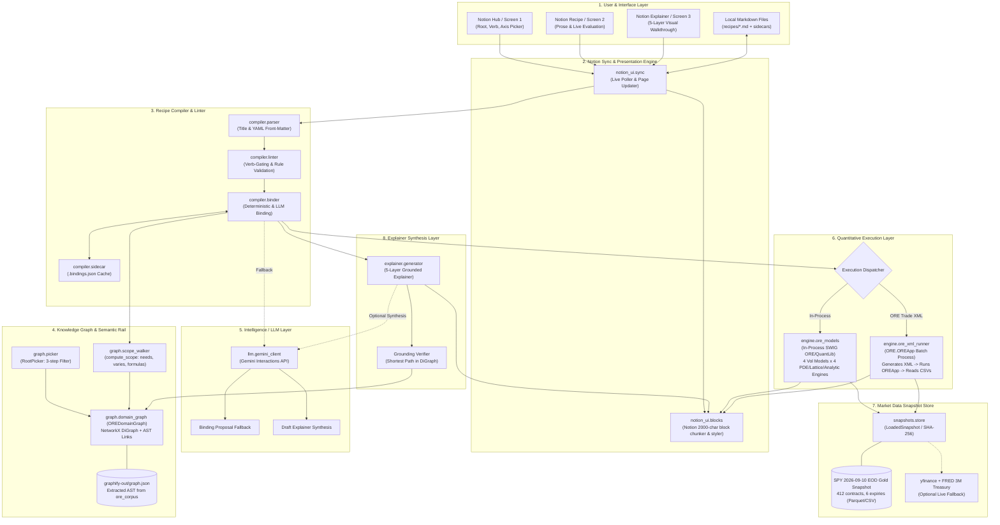
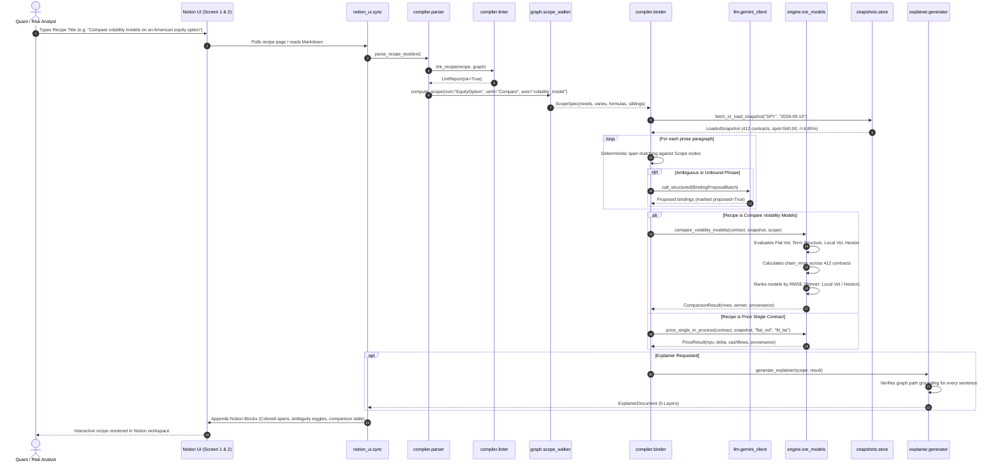

# Recipe Workbench v1: Project Architecture & Module Tracker

This document provides a comprehensive technical overview of the **Recipe Workbench v1** system, detailing every built module, its core components, high-level UML diagrams, and end-to-end dataflow.

---

## 1. Project Overview & Module Status

| Module | Status | Core Files | Key Classes / Functions | Primary Responsibility |
| :--- | :---: | :--- | :--- | :--- |
| **`graph`** | `Complete` | `domain_graph.py` `scope_walker.py` `picker.py` `build_graphify.py` `schema.py` | `OREDomainGraph` `RootPicker` `compute_scope()` `ScopeSpec` `GraphNode` | Bridges Graphify C++ AST with financial domain semantics; computes deterministic 5-rail scopes and guides 3-step root/verb/axis selection. |
| **`snapshots`** | `Complete` | `store.py` | `LoadedSnapshot` `SnapshotManifest` `OptionContractRow` `seed_spy_gold_snapshot()` | Immutable market data snapshots (SPY 412 contracts, 6 expiries) with SHA-256 chain integrity, Parquet/CSV storage, and yfinance/FRED fetcher. |
| **`engine`** | `Complete` | `ore_models.py` `ore_xml_runner.py` `schemas.py` | `price_single_in_process()` `compare_volatility_models()` `compare_pricing_engines()` `run_ore_app_trade()` | Dual execution backend: In-process SWIG QuantLib/ORE (4 vol models, 4 American PDE/binomial/analytic engines) and full OREApp XML batch runner. |
| **`compiler`** | `Complete` | `parser.py` `linter.py` `binder.py` `sidecar.py` | `parse_recipe_file()` `lint_recipe()` `compile_recipe()` `SidecarData` `CompiledRecipe` | Parses canonical Markdown titles and front-matter, validates syntax against graph rules, binds prose phrases to scope nodes, and manages sidecar files (`.bindings.json`). |
| **`llm`** | `Complete` | `gemini_client.py` | `call_structured()` `BindingProposalBatch` `RootPrefillProposal` `ExplainerDraft` | Interfaces with Google Gemini via Interactions API; proposes structured binding fallbacks and drafts grounded explainers when API keys are available. |
| **`explainer`** | `Complete` | `generator.py` | `generate_explainer()` `ExplainerDocument` `GroundedSentence` `verify_grounding()` | Synthesizes a 5-layer pedagogical document (Business, Quant, Architecture Mermaid, Object Drilldown, Verified Code) with rigorous graph-path grounding. |
| **`notion_ui`** | `Deprecated` | `blocks.py` `sync.py` | `build_hub_blocks()` `build_recipe_page_blocks()` `build_explainer_blocks()` `sync_recipe_to_notion()` | Legacy Notion block sync prototype. **Superseded** by custom dynamic web pages (see Section 6: Why Notion Won't Work). |
| **`api` & `web`** | `Active` | `api/server.py` `web/` | `/api/analyze`, `/api/compile` `/api/picker/*`, `/api/scope` | FastAPI + React/Vite dynamic quant recipe workspace: live keystroke keyword detection, interactive disambiguation, and dynamic recipe page generation. |
| **`corpus`** | `Complete` | `ore_corpus/` | `ore_swig_manifest.py` `oreapp.hpp` `market.hpp` `equityoption.hpp` | C++ ORE headers and Python SWIG bindings corpus feeding Graphify AST extraction into `graphify-out/graph.json`. |

---

## 2. High-Level System Architecture

---

## 3. High-Level UML Class Diagram

```mermaid
classDiagram
    direction TB

    %% Graph Package
    class OREDomainGraph {
        +Path graphify_path
        +dict raw_graphify
        +DiGraph nx_graph
        +Dict~str, GraphNode~ nodes
        +List~GraphEdge~ edges
        +str graph_version
        +get_node(node_id: str) GraphNode
        +find_path(source_id: str, target_id: str) List~str~
    }

    class GraphNode {
        +str id
        +str label
        +NodeCategory category
        +str layer
        +str description
        +str why
        +List~str~ aliases
        +str code_ref
        +str xml_tag
        +str engine_key
        +str axis
        +List~Verb~ allowed_verbs
        +bool is_data_leaf
    }

    class ScopeSpec {
        +str title
        +str slug
        +str root_id
        +str root_label
        +Verb verb
        +str axis
        +str graph_version
        +List~GraphNode~ needs
        +List~GraphNode~ varies
        +List~GraphNode~ formulas
        +List~GraphNode~ siblings
        +List~GraphEdge~ edges
        +all_in_scope_nodes() List~GraphNode~
        +in_scope_ids() set~str~
    }

    class RootPicker {
        +OREDomainGraph graph
        +filter_roots(query: str) List~CandidateHit~
        +filter_verbs(root_id: str, query: str) List~CandidateHit~
        +filter_axes(root_id: str, verb: Verb, query: str) List~CandidateHit~
        +parse_title(title_line: str) Tuple
    }

    %% Compiler Package
    class ParsedRecipe {
        +str path
        +str title_line
        +str asof
        +str symbol
        +List~str~ uses
        +ConventionsSpec conventions
        +List~RecipeParagraph~ paragraphs
    }

    class CompiledRecipe {
        +ParsedRecipe recipe
        +ScopeSpec scope
        +List~ParagraphAnnotation~ annotated_paragraphs
        +PriceResult price_result
        +ComparisonResult comparison_result
        +SidecarData sidecar
    }

    class BoundSpan {
        +int start
        +int end
        +str phrase
        +str target_id
        +str source
        +bool proposed
    }

    class SidecarData {
        +str slug
        +Dict~str, ConfirmedBinding~ bindings
        +Dict~str, str~ disambiguations
        +get_by_phrase(phrase: str) ConfirmedBinding
    }

    %% Engine Package
    class OptionContractSpec {
        +str symbol
        +str contract_symbol
        +str option_type
        +str exercise_style
        +float strike
        +str expiry
        +int dte
        +float quantity
        +str currency
    }

    class PriceResult {
        +OptionContractSpec contract
        +float npv
        +float delta
        +List~CashflowRow~ cashflows
        +List~str~ assumptions
        +ProvenanceRecord provenance
    }

    class ComparisonResult {
        +OptionContractSpec contract
        +str axis
        +List~ModelRow~ rows
        +str winner_model_id
        +str winner_model_name
        +ProvenanceRecord provenance
    }

    class ModelRow {
        +str model_id
        +str model_name
        +str engine_name
        +float price
        +float delta
        +float chain_rmse
        +int rank
        +float elapsed_ms
    }

    %% Snapshot Package
    class LoadedSnapshot {
        +SnapshotManifest manifest
        +List~OptionContractRow~ chain
        +str directory
        +resolve_contract(target_dte, moneyness, option_type) OptionContractRow
    }

    class SnapshotManifest {
        +str snapshot_id
        +str symbol
        +str asof
        +float spot
        +float risk_free_rate
        +float dividend_yield
        +int contract_count
        +str sha256_chain
    }

    %% Explainer Package
    class ExplainerDocument {
        +str title
        +str scope_slug
        +str graph_version
        +str layer_1_business
        +List~GroundedSentence~ layer_2_quant
        +str layer_3_architecture_mermaid
        +List~GroundedSentence~ layer_3_architecture_notes
        +List~ObjectDrilldownEntry~ layer_4_objects
        +str layer_5_code
        +str layer_5_verified_output
        +int ungrounded_count
    }

    %% Relationships
    OREDomainGraph "1" *-- "*" GraphNode : contains
    RootPicker --> OREDomainGraph : inspects
    ScopeSpec "1" o-- "*" GraphNode : filters
    CompiledRecipe "1" *-- "1" ParsedRecipe : wraps
    CompiledRecipe "1" *-- "1" ScopeSpec : enforces
    CompiledRecipe "1" *-- "1" SidecarData : updates
    CompiledRecipe "1" o-- "0..1" PriceResult : executes
    CompiledRecipe "1" o-- "0..1" ComparisonResult : executes
    ComparisonResult "1" *-- "*" ModelRow : ranks
    PriceResult "1" *-- "1" OptionContractSpec : targets
    ComparisonResult "1" *-- "1" OptionContractSpec : targets
    LoadedSnapshot "1" *-- "1" SnapshotManifest : validates
    ExplainerDocument ..> ScopeSpec : grounded by
    ExplainerDocument ..> OREDomainGraph : traces paths
```

---

## 4. End-to-End Execution Sequence

---

## 5. Architectural Quality Attributes

1. **Deterministic Guarantees**:
   - The knowledge graph version is a deterministic SHA-256 hash over nodes and relations (`v0.4-<hash>`).
   - Market snapshot data (`spy_2026-09-10_eod`) is hashed with a strict SHA-256 fingerprint, ensuring identical outputs offline or online.
   - Core entity extraction uses direct string/regex matching against graph labels, aliases, and code references; LLMs are strictly invoked as fallbacks.

2. **Dual-Path Execution**:
   - **In-Process Engine**: Fast SWIG bindings to QuantLib/ORE (`ORE.VanillaOption`, `ORE.FdBlackScholesVanillaEngine`, `ORE.FdHestonVanillaEngine`) for instantaneous multi-model comparison.
   - **Batch XML Engine**: Formal enterprise execution via `ORE.OREApp` generating standard XML configurations (`ore.xml`, `portfolio.xml`, `pricingengine.xml`) and parsing financial report outputs (`npv.csv`, `flows.csv`).

3. **5-Layer Grounded Explainability**:
   - Explainer documents avoid hallucination through the `verify_sentence_grounding()` engine, which maps technical claims directly to shortest graph paths between ORE code entities and financial concepts.

---

## 6. Architectural Decision: Why Notion Won't Work (Pivot to Dynamic Quant Recipe Pages)

> **Decision:** Do **not** build the primary Recipe Workbench UI on top of Notion. Build a **custom dynamic web workspace** (`api/server.py` + `web/`) that renders live, interactive pages for creating and executing quant recipes.

### Why Notion Does Not Fit
1. **No Real-Time Keystroke / Inline Span Interaction**: Notion's API is poll-based with rate limits and 2,000-character block chunking. It cannot support sub-50ms keystroke-level ORE keyword highlighting, live margin diagnostics, or hover/click inspection on bound quant spans.
2. **Static Block Model vs. Dynamic Recipe Pages**: Notion pages are static document trees. What we actually need are **dynamic pages that construct and mutate quant recipes on the fly**—where choosing a root, resolving an ambiguity (e.g., *ORE In-Process Instrument* vs. *OREApp XML Trade*), or toggling models/calculators immediately rebuilds the scope rail, mounts interactive parameter controls, and re-runs ORE pricing/comparisons inline.
3. **No Custom Interactive Quant Widgets**: Notion cannot host live inline disambiguation modals, interactive volatility-surface/RMSE comparison tables, calculator pickers, or side-by-side 5-layer explainers bound directly to the `ScopeSpec` graph.
4. **Sync Fragility & Latency**: Polling Notion blocks, diffing user prose edits against generated result blocks, and rewriting pages introduces multi-second latency and race conditions that break the interactive quant authoring loop.

### Target UX: Dynamic Quant Recipe Pages
- **Single Dynamic Canvas**: Users type natural language or use the guided Root → Verb → Axis picker, and the page dynamically assembles itself into an executable quant recipe.
- **Live Scope Rail & Inline Controls**: As prose is edited, deterministic keyword detection (`/api/analyze`) highlights instruments, models, inputs, and calculators in real time, surfacing ambiguity cards and dynamic parameter pills directly in the page.
- **Live ORE Execution & Grounded Explainers**: Compiling (`/api/compile`) executes ORE/QuantLib deterministically and streams structured results (NPV, Greeks, 4-model RMSE comparison tables, provenance hashes, and 5-layer grounded explainers) directly into reactive UI components.

---

## 7. LLM Integration Points & Model Sizing Strategy

### Where the LLM Integrates (and Where It Does Not)

| Pipeline Stage | LLM Role | Current Status |
| :--- | :--- | :--- |
| **1. Prompt → Dynamic Recipe Scaffold** | Turn a natural-language quant goal into a structured `RootPrefillProposal` (root, verb, axis, initial contract & calculator widgets) constrained to `OREDomainGraph`. | Schema defined (`RootPrefillProposal` in `llm/gemini_client.py`); ready to wire into `api/server.py`. |
| **2. Fuzzy Prose-to-Graph Binding** | Fallback when deterministic alias/regex matching misses paraphrased quant concepts (`BindingProposalBatch`). Proposals are marked `proposed=True` for user confirmation. | Implemented in `compiler/binder.py` (`_propose_llm_bindings`); currently disabled in `api/server.py` (`use_llm_fallback=False`). |
| **3. 5-Layer Grounded Explainer Synthesis** | Drafts Business Intuition, Technical Intuition, Architecture Map, and Object Drilldown (`ExplainerDraft`), then every sentence is verified against graph shortest paths (`verify_sentence_grounding`). | Implemented in `explainer/generator.py`. |
| **4. Interactive Recipe Refinement** | Conversational edits to an existing dynamic recipe page (e.g., *"switch to 60D OTM calls and compare pricing engines"*). | Planned for dynamic web UI. |
| **Keystroke Analysis & Quant Pricing** | **NO LLM.** Keystroke span detection (`/api/analyze`), scope walking, ORE/QuantLib pricing, RMSE ranking, and SHA-256 provenance remain 100% deterministic. | Enforced by design. |

### How Powerful Should the Model Be?
Because the ORE Knowledge Graph (`ScopeSpec`) strictly bounds the valid vocabulary and ORE/QuantLib performs all numerical computation, **a tiered model strategy** is optimal:

1. **Fast / Lightweight Structured-Output Model (Default — ~85–90% of calls)**
   - **Use for:** `RootPrefillProposal`, `BindingProposalBatch`, parameter extraction, and dynamic page widget scaffolding.
   - **Why:** These are tightly constrained JSON classification/extraction tasks over a small node list (`ScopeSpec`). Low latency (<1s) and strict JSON schema adherence matter far more than deep reasoning.
   - **Current default:** `gemini-4-hydrogen` (fast Flash-tier class) in `llm/gemini_client.py`.

2. **Stronger Pro / Reasoning-Tier Model (On-Demand — ~10–15% of calls)**
   - **Use for:** Complex multi-step quant recipe generation from underspecified prompts, and rich 5-layer `ExplainerDraft` technical narratives interpreting model calibration differences (e.g., Local Vol vs. Heston RMSE trade-offs and ORE C++ architecture).
   - **Why:** Better quantitative finance intuition and cleaner prose, while still strictly post-checked by `verify_sentence_grounding()` so it cannot hallucinate ORE classes or numbers.
